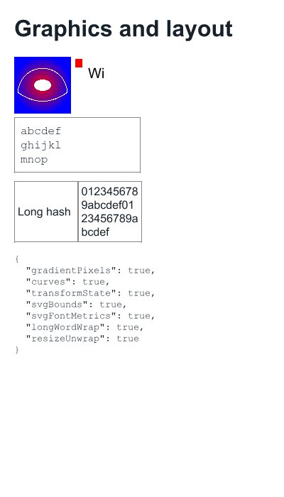
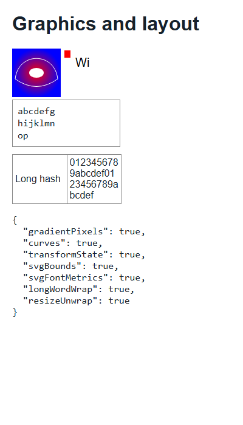

# Scoped compatibility completion — 2026-10-09

The agreed Sannysoft/CreepJS pass is complete locally: Canvas2D/SVG collectors,
practical long-word layout fixes, canvas display and diagnostic cleanup. Iframe
realm redesign, WebGL, WebRTC, audio and speech remain explicitly deferred.
See the [current roadmap](fingerprinting-compatibility-roadmap.md) for precise limits.

## Measured results

Final runs used Broiler.JS at 1280×900 with **HtmlBridge preview.32** and **Layout
preview.23**, restored from local feeds. Both sites were unmodified. Each completed
`--analyze --no-window` and a separate ordinary `--capture-image` run. Packages were
packed locally, not published; informational Git hashes identify the base commits
and do not include these uncommitted changes. HTML remains preview.25, DOM preview.14,
CSS preview.16, JavaScript preview.7 and JSEAL preview.6.

| Check | Result |
| --- | --- |
| CreepJS Canvas2D / SVG | Both collectors report passed and produce data |
| CreepJS worker / navigator / headless / rects / media | All report passed |
| CreepJS result | FP ID and fuzzy output populated; parent DOM survives |
| Sannysoft result | 20 scanner rows, 5 canvas hashes, 32 fingerprint JSON fields |
| Script failures / unhandled rejections | 0 / 0 on both sites |
| Layout invariant violations | 0 on both sites |
| CreepJS caught console errors | 0; expected first-chance probe exceptions remain |
| Reduced fixture | All 7 checks pass in Broiler and Chrome 154.0.8037.98 |

The [compact evidence](repros/fingerprinting-completion-observed-2026-10-09.json)
contains loaded versions, results and SHA-256 hashes of the fetched HTML/scripts.
Detailed reports and ordinary captures are under
`artifacts/compatibility-completion/final/`. These are compatibility observations;
failed bot scores and unsupported collectors are not converted into fake successes.

## Implemented changes

**Canvas/SVG (HtmlBridge).** Linear and radial gradients paint actual pixels, with
color-stop validation and saved/restored paint state. Ellipses, cubic and quadratic
curves use bounded flattening. Affine state affects path coordinates, rectangles,
text and image copies; transform queries return independent snapshots. SVG getBBox
uses supported shape geometry/group unions; text lengths and character extents use
font advances and respond to CSS font changes. Invalid character indices report
DOMException errors. The old tests that pinned character-count estimates now check
finite inherited-font fallback and measured widths instead.

**Canvas display (HtmlBridge + Layout).** The reference screenshot exposed a missing
handoff: canvas readback contained pixels while the page renderer showed a blank box.
The isolated render projection now carries a PNG in `data-broiler-canvas-bitmap`,
and Layout paints it as replaced image content while retaining the canvas tag,
selectors and sizing rules. The script-visible DOM receives no synthetic attribute.
A host with no encoder keeps its previous serialization behavior. An integration
test checks an actual red screenshot pixel and canonical-DOM isolation.

**Layout.** The 104 original / 130 later CreepJS line-order reports came from unused
line objects projected at (0,0), not reversed visible text. Fragment projection now
omits lines with neither words nor rectangles; actual blank lines remain. Emergency
wrapping splits oversized words on grapheme boundaries using font measurement and
restores the original words before relayout. `overflow-wrap: break-word` and its
`word-wrap` alias work in narrow fixed-width cards/table cells; `nowrap` and `pre`
retain their unbroken behavior. A wider resize removes stale splits.

**Diagnostics.** Embedded stylesheet source no longer becomes a collapsed-text
finding. SVG image elements are not obsolete HTML; HTML inside SVG foreignObject
remains classified as HTML. Repeated failed requests are grouped by scope, URL,
destination and outcome, with every original request retained in network.json.
The earlier nine Sannysoft 404s split into four synchronous image requests in the
analysis run and five in the separate window run, all initiated by Sannysoft for
`https://intoli.com/nonexistent-image.png`. The final no-window run has four.
This is its intentional broken-image test, not nine independent connectivity bugs.
The loader can still request it repeatedly; failure caching was not introduced.

CreepJS's `<image class="gl-image" />` occurs in HTML, not SVG. Its parser diagnostic
is therefore retained. The older parser message's general claim that a browser
leaves this particular tag open is imprecise: HTML treats `image` as an `img` alias.
That parser behavior/message remains a known upstream limitation. Caught feature
probes, console output and uncaught failures stay separate in the existing report.

## Validation and visual comparison

| Suite | Passed | Existing skips | Failed |
| --- | ---: | ---: | ---: |
| HtmlBridge Release | 2,218 | 21 | 0 |
| HtmlBridge Release-VM | 2,274 | 21 | 0 |
| Layout Release | 3,021 | 0 | 0 |
| Browser CLI | 227 | 0 | 0 |
| Browser Core | 319 | 0 | 0 |
| Traffic | 20 | 0 | 0 |
| Engine-neutrality guard tests | 6 | 0 | 0 |

The engine-neutrality budget check passes for all five projects. Packaging verified
five bridge packages and one Layout package. The final isolated CLI build has zero
warnings/errors; Layout's build retains its pre-existing compiler warnings.

The [committed fixture](repros/fingerprinting-graphics-layout.html) checks gradient
pixels, curve output, transform state, SVG shape bounds, relative glyph advances,
long-word wrapping and resize restoration. Browser's
[verification runner](../eng/verify-fingerprinting.ps1) asserts these and the live
collector/result gates. It records source hashes so changing sites can be reviewed.

At a 400×700 viewport the fixture has equivalent content and a visible canvas in
both engines. Broiler's monospace font wraps six letters per line where Chrome wraps
seven; table/text baselines also differ slightly. This is not a claim of visual or
font-rasterization parity.

| Broiler | Chrome reference |
| --- | --- |
|  |  |

Live captures: [CreepJS](images/creepjs-completed-2026-10-09.png) and
[Sannysoft](images/sannysoft-completed-2026-10-09.png). Additional 400×900 captures
are retained with the local artifacts. Site tables can still overflow narrow
viewports; the emergency-wrap fix does not override authored intrinsic sizing.

## Remaining boundaries

No realm redesign or large media/graphics subsystem was added. The roadmap records
remaining SVG shaping/outline accuracy, Canvas interface and stroke/shadow/clip
limits, CSS min-content/ellipsis/axis-overflow gaps and font differences. Local
package publication and source commits remain separate release work.

Canvas transform/gradient behavior was checked against the
[HTML Canvas specification](https://html.spec.whatwg.org/multipage/canvas.html).
Passing the reduced fixture and live collectors is the acceptance criterion for
this scoped implementation, not full standards conformance.
