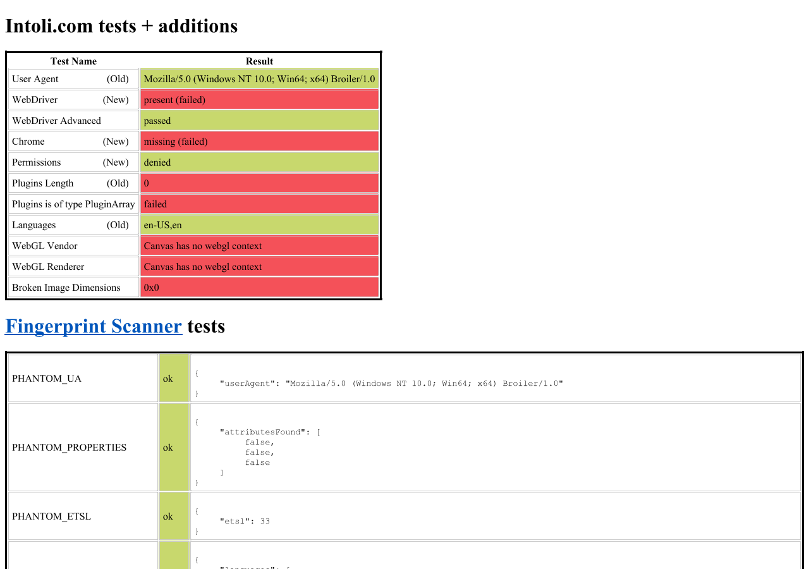
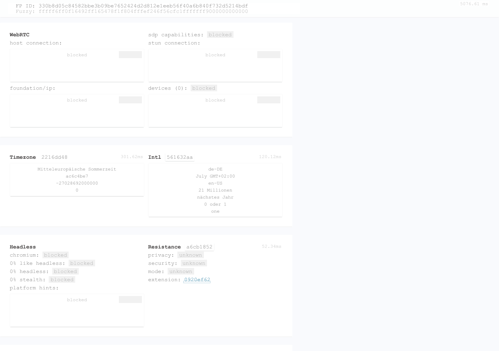

# Sannysoft and CreepJS: current-package reinvestigation

Later implementation and validation: [scoped completion report](fingerprinting-completion-2026-10-09.md). The measurements below remain the original preview.25 baseline.

Measured on **2026-10-09 at 13:50–13:55 UTC (15:50–15:55 Europe/Berlin)**.
Both unmodified live sites now render with the current NuGet packages. The old
CreepJS process crash and the earlier Sannysoft result-population blockers did
not recur. Both still have API and rendering compatibility gaps.

The active priorities and acceptance criteria are in the
[compatibility roadmap](fingerprinting-compatibility-roadmap.md). This report is
a dated baseline; completed work and open work must not be inferred from the
older investigations alone.

## Reproducible baseline

| Component | Revision/version actually used |
| --- | --- |
| Browser | `a18f0b6ee425468eed72300dd2b4065ff2ea6c1d` |
| HtmlBridge checkout and loaded packages | `0.1.0-preview.25+784cd50f76897a1b8682abd2543f881f546c18b1` |
| JavaScript packages | `0.1.0-preview.7+5385af142ef1753fca00998482800f70e6b950f2` |
| JSEAL | `0.1.0-preview.6+4c3040f40c384c0ec5b7bf1f42a93a70bff6004d` |
| HTML / Layout / CSS / DOM | preview.25 / preview.21 / preview.16 / preview.14 |
| Host | Windows x64 build 26200; SDK 10.0.401; .NET 10.0.12 |
| Configuration | Release, Broiler.JS, 1280×900 |

Both checkouts were clean before this investigation. The isolated build completed
with zero warnings/errors. No local DLL replacement, site-script modification or
API bypass was used. Broiler.VM and a reference Chromium render were not tested in
this pass. The runs were concurrent, so durations are observations, not benchmarks.

| Measurement | Sannysoft | CreepJS |
| --- | --- | --- |
| `--analyze` / ordinary `--capture-image` exit codes | 0 / 0 | 0 / 0 |
| Analysis duration, including window comparison | 40.27 s | 30.03 s |
| BrowserApp comparison | Done, settled, difference ratio 0 | Done, settled, difference ratio 0 |
| Analyzer script failures / unhandled rejections | 2 / 1 | 1 / 1 |
| Requests across analysis and window scopes | 37; 9 failed | 15; 0 failed |
| Layout invariant warnings | 0 | 104 |
| Result DOM | 20 scanner rows, fingerprint JSON with 32 top-level keys, five canvas hashes | 246 → 2,316 elements, FP ID and fuzzy fingerprint populated |

The analyzer's failure count excludes caught errors printed through
`console.error`; CreepJS also printed eight such errors in each page load.
Image-capture diagnostics count these differently (nine CreepJS diagnostics and
three Sannysoft diagnostics). Exit 0 and the analyzer's window comparison are
completion/parity checks, not full compatibility or a comparison to Chromium.

## What is now working

- The proxy-cycle fixture catches `RangeError: Maximum call stack size exceeded`.
  Live analysis and normal capture survive using published JavaScript preview.7.
- Sannysoft's reduced fixture confirms successful image load/error events and
  dimensions, parser-time writes inside their table cell, `innerText` assignment,
  `PluginArray` exposure, and 1280×900 viewport/screen values. The live plugin-type
  cell contains `failed`; it is no longer blank.
- CreepJS's fixture confirms `new DocumentFragment()`, child-window indexing,
  separate child documents, preserved parent content, console grouping methods,
  and the `Crypto` interface with `crypto.subtle.digest` exposed. This checks API
  presence and the recorded behavior, not complete conformance of each interface.

The historical CreepJS P1 bootstrap work can therefore be closed for these tested
cases. Iframe **realm isolation** remains open, separately from document isolation.

## Remaining failures and their causes

### CreepJS worker environment — FP-01

`exceptions.log` places `ReferenceError: navigator is not defined` on thread
`broiler-worker:./creep.js`, in both analysis and the window pass. The main page
then logs missing `workerScope.platform`, `userAgent`, `deviceMemory` and
`hardwareConcurrency`. The worker failure is also reported as an unhandled rejection.

The new [HTTP worker probe](repros/fingerprinting-current-probes.html) successfully
receives a message, demonstrating that worker startup and messaging work. Inside
that worker, `navigator`, `WorkerNavigator`, `WorkerGlobalScope` and
`DedicatedWorkerGlobalScope` are all undefined; `self === globalThis`, `crypto`
and `performance` work. `JSWorker.InstallWorkerGlobals` confirms the missing
registrations. CreepJS begins with `!self.document && self.WorkerGlobalScope`, so
the missing worker-global interface also makes its scope detection falsy. Fixing
only `navigator` is insufficient as a completion criterion.

The [HTML worker interfaces](https://html.spec.whatwg.org/multipage/workers.html#the-workernavigator-interface)
provide the contract: worker `navigator` is a `WorkerNavigator` with the applicable
identity, language, online-state and concurrency members. Implement these in the
worker's own realm using shared host identity data; then rerun to identify any
newly reached failures.

### Window interfaces and iframe realms — FP-02 / FP-06

CreepJS catches `ReferenceError: Window is not defined` and displays a blocked
Headless section. The local probe finds both `Window` and `Navigator` undefined.
Adding an interface name alone is inadequate: the object's prototype, descriptors,
brand checks and non-constructability where required need consistent behavior.

The child frame has its own document, but `child.Function === Function` and
`child.Object === Object` are both true. A temporary marker written on the child
`Object.prototype` appears on the parent's prototype. The fixture removes it
after observing the leak. CreepJS cannot obtain a clean comparison realm from such
an iframe. This is a measured isolation gap, not an attribution of every CreepJS
lie report to one defect.

### Client rectangles — FP-03

The live exception stack points to the element-rectangle map at downloaded
`creep.js:4138–4139`, before its Range map: `el.getClientRects()[0]` is undefined.
The exact failing site element has not yet been isolated. The new fixture exposes
three narrower issues:

- A visible 100×20 element returns one rectangle, but the list is an Array with no
  `item()` method; `DOMRect` and `DOMRectList` globals are undefined.
- An attached zero-size block returns an empty list. `ElementGeometryBinding`
  currently filters out rectangles when both dimensions are zero.
- A Range selecting the visible text returns an empty list, even after querying
  the element's geometry.

[CSSOM View](https://drafts.csswg.org/cssom-view/#dom-element-getclientrects)
requires fragment rectangles, including zero-size border areas for elements that
have layout boxes, and a `DOMRectList`. Distinguish zero-size boxes from elements
without boxes. The live failure and reduced results justify a geometry repair;
they do not prove that one condition explains all site measurements.

### Canvas and SVG — FP-05

The two caught `undefined is not a function` errors have stacks in `getSVG` and
`getCanvas2d`; the canvas stack includes the radial-gradient helper at line 3031.
The reduced probe confirms missing `createRadialGradient`, `ellipse`,
`getTransform`, SVG `getBBox`, and `getExtentOfChar`. SVG text-length methods are
present. SVG source calls `svgBox.getBBox()` at line 7691.

Sannysoft's five canvas cells contain the same hash (`-1632150322`). This proves
the collector completed those cells; it does not prove pixel, font, transform or
cross-frame rendering correctness. Add pixel/geometry comparisons when repairing
the graphics APIs. Both fixtures report no WebGL context.

### Sannysoft media APIs — FP-04

`navigator.mediaDevices` is undefined. The live enumeration script rejects on
`enumerateDevices`, leaving the media output unpopulated. This is a modern API
compatibility gap. HtmlBridge's current `NavigatorSurfacesBinding` deliberately
leaves the media capability decision to the media layer; a repair must connect to
that capability/permission model.

The other script failure is exactly `document.write(navigator.getUserMedia());`.
This deprecated method is absent, and the site calls it with no arguments. Do not
make this invalid invocation return a success value just to remove a diagnostic.
Treat legacy support as an explicit compatibility decision with argument and
error behavior tested separately. The modern
[Media Capture contract](https://www.w3.org/TR/mediacapture-streams/#dom-mediadevices-enumeratedevices)
must govern enumeration, secure-context exposure and permission behavior.

### Layout and diagnostics — FP-07 / FP-08

CreepJS produces 104 invariant reports, including line Y ordering such as
`131 > 0`; the site now reaches enough result content to expose these. This is a
newly measurable layout issue requiring a minimized case. Some findings may
involve empty/hidden fragments; neither every warning nor a particular visual
defect has been causally proven. Ignored properties are `animation`,
`overflow-wrap`, `overflow-y` and `text-overflow`; Sannysoft reports ignored
`word-wrap` on 46 elements. No horizontal overflow is recorded for Sannysoft.

All nine failed Sannysoft requests are the deliberately nonexistent Intoli image
(404), spread across the two independent page loads. The 404 is expected; repeated
fetches merit a separate initiator/cache review. No analytics timeout recurred.
CreepJS's `<image/>` warning needs namespace-aware classification before treating
SVG syntax as an HTML parser defect. Several collapsed-text warnings contain
`style` text, so they are not evidence that reader-visible labels disappeared.

Thousands of CreepJS first-chance exceptions and the 44 near-stack-exhaustion
exceptions include intentional feature/proxy tests. Keep process termination,
uncaught failures, caught feature tests and unsupported capabilities distinct.
Red results for Broiler's identity, automation flag, empty plugins, denied
permissions or unsupported WebGL are not by themselves implementation failures.

## Current images and retained evidence





[Durable evidence JSON](repros/fingerprinting-observed-2026-10-09.json) records loaded
versions, results, diagnostics, probe output and SHA-256 hashes. Full reports,
downloaded resources, screenshots, layouts and logs remain under
`artifacts/compatibility-2026-10-09-current/` (Git-ignored). Preserve that directory
separately when sharing raw evidence; hashes do not reconstruct downloaded files.

## Repeat the investigation

From the Browser checkout in PowerShell:

```powershell
$run = 'artifacts/compatibility-2026-10-09-current'
dotnet build src/Broiler.Browser.Cli/Broiler.Browser.Cli.csproj -c Release `
  --artifacts-path "$run/build"
$cli = "$run/build/bin/Broiler.Browser.Cli/release/Broiler.Cli.dll"

dotnet $cli --analyze https://bot.sannysoft.com/ --output-dir "$run/sannysoft" `
  --width 1280 --height 900 --analysis-timeout 180 --verbose
dotnet $cli --analyze https://abrahamjuliot.github.io/creepjs/ --output-dir "$run/creepjs" `
  --width 1280 --height 900 --analysis-timeout 180 --verbose
dotnet $cli --capture-image https://bot.sannysoft.com/ --output "$run/sannysoft-capture.png" `
  --width 1280 --height 900 --diagnostic-dir "$run/sannysoft-capture-diagnostics"
dotnet $cli --capture-image https://abrahamjuliot.github.io/creepjs/ --output "$run/creepjs-capture.png" `
  --width 1280 --height 900 --diagnostic-dir "$run/creepjs-capture-diagnostics"

dotnet $cli --evaluate-page docs/repros/sannysoft-platform-probes.html `
  --evaluate 'JSON.stringify(probeResults)' --width 1280 --height 900 --output "$run/sannysoft-probes.json"
dotnet $cli --evaluate-page docs/repros/creepjs-platform-probes.html `
  --evaluate 'JSON.stringify(observations)' --width 1280 --height 900 --output "$run/creepjs-probes.json"
dotnet $cli --evaluate-page docs/repros/creepjs-proxy-cycle.html `
  --evaluate "document.getElementById('result').textContent" --output "$run/proxy-cycle.json"
```

Serve the new worker fixture in a separate terminal with
`python -m http.server 8765 --bind 127.0.0.1 --directory docs/repros`, then run:

```powershell
dotnet $cli --evaluate-page http://127.0.0.1:8765/fingerprinting-current-probes.html `
  --evaluate 'JSON.stringify(observations)' --width 1280 --height 900 --output "$run/followup-probes.json"
```

Stop the server afterward. The worker result must be `state: "message"`, not
`pending` or `timeout`. These fixtures record observations; they are not an
automated conformance suite. This documentation pass changed no production code
and did not rerun component unit suites.
